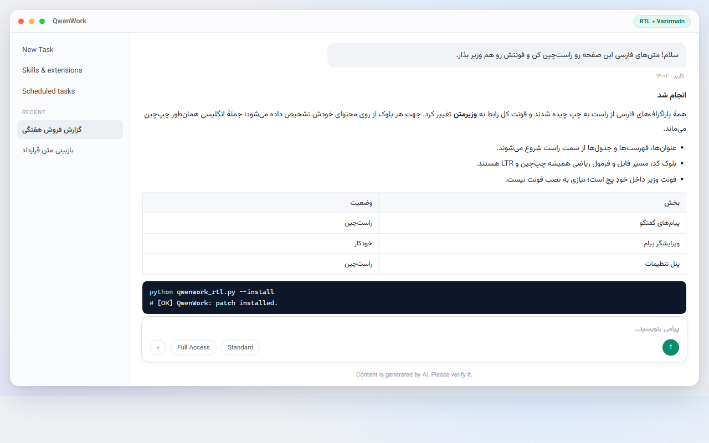

<div dir="rtl" align="right">



<sub><i>نمونهٔ شبیه‌سازی‌شده از رابط بعد از نصب پچ: چیدمان راست‌چین، فونت وزیرمتن، بلوک کد چپ‌چین.</i></sub>

# QwenWork RTL + Vazirmatn

**متن فارسی راست‌چین و فونت وزیرمتن برای QwenWork — و بعد از آپدیت برنامه هم سر جایش می‌ماند.**

[](CHANGELOG.md)
[](LICENSE)
[](#پیشنیازها)
[](#پیشنیازها)
[](https://github.com/neeM4c/qwenwork-rtl/stargazers)

[English](README.md) · [فارسی](README.fa.md) · [راهنمای کامل](docs/USAGE.fa.md) · [حمایت مالی](#-حمایت-از-پروژه)

</div>

<div dir="rtl" align="right">

## چرا این پروژه؟

رابط QwenWork فقط چپ‌چین است و فونتش هم فونت لاتین است. نتیجه این می‌شود که:

- گفتگوی فارسی از سمت چپ شروع می‌شود و انتهای خطوط به‌هم می‌ریزد،
- ستون‌های جدول برعکس خوانده می‌شوند،
- و متن فارسی با فونتی نمایش داده می‌شود که برای فارسی طراحی نشده.

این ابزار یک فایل داخل برنامه (`out/renderer/index.html` در `resources/app.asar`) را ویرایش می‌کند و
یک تکه کد کوچک و مستقل به آن اضافه می‌کند که:

- **جهت هر بلوک را از روی محتوای خودش** تشخیص می‌دهد (فارسی → راست‌چین، انگلیسی → چپ‌چین)،
- **فونت وزیرمتن** را داخل خودِ پچ بارگذاری می‌کند؛ نه نصب فونت لازم است، نه دانلود.

هیچ سروری در کار نیست، هیچ داده‌ای جایی نمی‌رود، و هیچ برنامه‌ای در پس‌زمینه نصب نمی‌شود (به‌جز نگهبان
اختیاری که در بخش «بعد از آپدیت‌ها» توضیح داده شده).

<details>
<summary>بیشتر بدانید: دقیقاً چه چیزی در برنامه تغییر می‌کند؟</summary>

یک بلوک `<style>` و یک بلوک `<script>` درست قبل از `</head>` فایل HTML رابط اضافه می‌شود. هر دو بین
علامت‌های `<!-- RTL-PATCH-START -->` و `<!-- RTL-PATCH-END -->` قرار می‌گیرند، پس حذف پچ بازگردانیِ
دقیق و بایت‌به‌بایت است. اندازه‌های هدر آرشیو، آفست فایل‌ها و بلوک integrity همان یک فایل دوباره محاسبه
می‌شود و بعد همهٔ فایل‌های بسته یکی‌یکی بررسی می‌شوند تا آرشیو نهایی جایگزین شود.
</details>

## امکانات

| امکان | توضیح |
| --- | --- |
| **جهت خودکار** | هر پاراگراف، عنوان، آیتم فهرست، سلول جدول و بلوک پیام جداگانه بررسی می‌شود. فارسی راست‌چین، انگلیسی چپ‌چین. هیچ «آینه‌کردن کل رابط» در کار نیست. |
| **وزیرمتن آماده** | فونت متغیر (حدود ۲۴۰ کیلوبایت) به‌صورت base64 داخل پچ قرار دارد؛ نه نصب لازم است، نه اینترنت. |
| **کد همیشه LTR** | بلوک کد، کد درون‌خطی، فرمول ریاضی، ترمینال و ادیتور Monaco چپ‌چین می‌مانند و به‌هم نمی‌ریزند. |
| **مناسب پاسخ‌های استریمی** | یک `MutationObserver` با آمدن هر توکن دوباره بررسی می‌کند، پس جهت متن همان لحظه‌ای که اولین حرف فارسی می‌رسد درست می‌شود. |
| **هوشمند در ویرایشگر پیام** | با تایپ فارسی، کادر پیام راست‌چین می‌شود و با تایپ انگلیسی به چپ‌چین برمی‌گردد. |
| **مقاوم در برابر آپدیت** | نگهبان اختیاری هنگام روشن‌شدن ویندوز اجرا می‌شود و اگر آپدیت پچ را پاک کند، در چند ثانیه برمی‌گرداند. |
| **حذف با یک دستور** | `--restore` تکه اضافه‌شده را برمی‌دارد و فایل اصلی برمی‌گردد. |
| **بدون وابستگی** | فقط کتابخانهٔ استاندارد پایتون؛ نه `pip install`، نه Node، نه فایل اجرایی بیرونی. |

## پیش‌نیازها

- **ویندوز ۱۰ یا ۱۱** (این پچ برای نسخهٔ ویندوزی QwenWork نوشته شده)
- **QwenWork** نصب‌شده در `C:\Program Files\QwenWork` (مسیر پیش‌فرض) یا `%LOCALAPPDATA%\Programs\QwenWork`
- **پایتون ۳.۸ یا بالاتر** که با `python` یا `py` در دسترس باشد
- دسترسی مدیر سیستم — فایل برنامه داخل `Program Files` است؛ اسکریپت خودش درخواست دسترسی می‌دهد

## شروع سریع

```powershell
git clone https://github.com/neeM4c/qwenwork-rtl.git
cd qwenwork-rtl
python qwenwork_rtl.py --install
```

اگر ترجیح می‌دهید کلیک کنید: مخزن را به‌صورت ZIP دانلود و استخراج کنید و روی **`QwenWork-RTL.bat`**
دوبار کلیک کنید (گزینهٔ `1`). وقتی ویندوز پرسید، اجازهٔ دسترسی مدیر (UAC) را بدهید.

بعد از اجرا:

۱. اگر QwenWork باز باشد بسته می‌شود (برای آزادشدن فایل آرشیو لازم است).
۲. پچ تزریق می‌شود، آرشیو بازسازی و بررسی می‌شود.
۳. QwenWork دوباره باز می‌شود؛ هر گفتگوی فارسی راست‌چین و با فونت وزیر است.

## استفاده

اگر اسکریپت را بدون آرگومان اجرا کنید، یک منوی ساده می‌بینید:

```text
  [1] Install / update patch
  [2] Show status
  [3] Remove patch (restore the original look)
  [4] Install / repair the auto-repair guard
  [5] Remove the auto-repair guard
```

همهٔ کارها از خط فرمان هم انجام می‌شود:

| دستور | کار |
| --- | --- |
| `python qwenwork_rtl.py --install` | نصب، به‌روزرسانی یا تعمیر پچ (درخواست دسترسی مدیر). |
| `python qwenwork_rtl.py --status` | نمایش وضعیت: آرشیو پیدا شد یا نه، پچ خورده یا نه، به‌روز است یا نه، نگهبان نصب است یا نه. |
| `python qwenwork_rtl.py --restore` | حذف پچ و بازگشت به ظاهر اصلی. |
| `python qwenwork_rtl.py --install-guard` | ثبت نگهبان در زمان روشن‌شدن ویندوز (تسک `RTL Patch Guard`). |
| `python qwenwork_rtl.py --remove-guard` | حذف نگهبان. |
| `python qwenwork_rtl.py --watch --silent` | اجرای حلقهٔ نگهبان در پیش‌زمینه (توسط تسک زمان‌بندی‌شده). |

راهنمای گام‌به‌گام و رفع اشکال: **[docs/USAGE.fa.md](docs/USAGE.fa.md)**.

## بعد از آپدیت‌ها

آپدیت‌ها فایل `app.asar` را عوض می‌کنند و پچ پاک می‌شود. دو چیز باعث می‌شود پچ دوام بیاورد:

- اسکریپت هیچ نسخه‌ای را هارد‌کد نمی‌کند؛ نسخهٔ فعال را از `updater.cfg` (کلید `currentVersion`) می‌خواند و
  اگر نشد، جدیدترین پوشهٔ نسخه را پیدا می‌کند. یعنی پوشهٔ نسخهٔ جدید خودکار شناسایی می‌شود.
- **نگهبان**: یک تسک زمان‌بندی‌شده که هنگام ورود به ویندوز با بالاترین دسترسی شروع می‌شود و هر ۱۵ ثانیه
  بررسی می‌کند. اگر ببیند QwenWork بسته است و آرشیو پچ ندارد، خودش پچ را برمی‌گرداند.

```powershell
python qwenwork_rtl.py --install-guard   # یک بار
python qwenwork_rtl.py --status          # guard: True
```

فایل لاگ: `%LOCALAPPDATA%\RTL-Patch\guard.log`

## بازگردانی

```powershell
python qwenwork_rtl.py --restore
```

تکهٔ اضافه‌شده از آرشیو حذف می‌شود و فایل اصلی دقیقاً برمی‌گردد. هیچ فایل بکاپ اضافه‌ای باقی نمی‌ماند.

## چطور کار می‌کند؟

```text
resources/app.asar
└── out/renderer/index.html   ← فقط یک بلوک style و یک بلوک script
```

- تکهٔ کد دقیقاً قبل از `</head>` درج می‌شود و بین دو علامت کامنت قرار می‌گیرد.
- جهت هر بلوک از روی اولین حرف قوی آن تعیین می‌شود (`[\u0600-\u06FF]` → راست‌چین، `[A-Za-z]` → چپ‌چین) و
  به‌صورت `dir="rtl"` با `text-align: right` اعمال می‌شود.
- عناصری که با `pre`، `code`، `.katex`، `.monaco-editor`، `.xterm` و بلوک‌های کد/فرمول مطابقت دارند رد می‌شوند.
- آرشیو asar با هدر، آفست‌ها و بلوک‌های SHA-256 اصلاح‌شده بازسازی می‌شود و قبل از جایگزینی، همهٔ فایل‌ها
  دوباره خوانده و مقایسه می‌شوند.

## رفع اشکال

| نشانه | راه‌حل |
| --- | --- |
| `archive is locked` | QwenWork را کامل ببندید (از سینی هم) و دوباره اجرا کنید. |
| `No matching app found` | QwenWork در مسیر پشتیبانی‌شده نیست؛ یک Issue با مسیر نصب باز کنید. |
| پچ خورد ولی چیزی عوض نشد | پنجره را با `Ctrl+R` رفرش کنید؛ اگر هنگام پچ باز بوده، برنامه را ببندید و باز کنید. |
| فارسی راست‌چین شد ولی فونت عوض نشد | در آن پنل ممکن است قاعدهٔ دیگری فونت را تعیین کند؛ با اسکرین‌شات Issue باز کنید. |
| بعد از هر آپدیت پچ می‌پرد | نگهبان را نصب کنید (گزینهٔ `4` یا `--install-guard`). |

## پرسش‌های متداول

<details><summary><b>امن است؟ برنامه را خراب نمی‌کند؟</b></summary>

تنها تغییر، ویرایش یک فایل HTML داخل آرشیو است. آرشیو بازنویسی‌شده قبل از جایگزینی فایل‌به‌فایل بررسی
می‌شود و `--restore` فایل اصلی را برمی‌گرداند. اگر هم چیزی خراب شد، یک بار از خود QwenWork آپدیت بگیرید
تا نسخهٔ رسمی برگردد.
</details>

<details><summary><b>به حساب یا گفتگوهای من دست می‌زند؟</b></summary>

نه. هیچ داده‌ای جایی فرستاده نمی‌شود و فقط ظاهر (`dir`، `text-align` و `font-family`) تغییر می‌کند.
</details>

<details><summary><b>چرا یک تنظیم رسمی در خود برنامه نیست؟</b></summary>

چون هنوز چنین گزینه‌ای وجود ندارد. این یک راه‌حل محلی و برگشت‌پذیر است تا وقتی QwenWork پشتیبانی رسمی
از راست‌چین اضافه کند.
</details>

<details><summary><b>روی مک یا لینوکس کار می‌کند؟</b></summary>

منطق پچ مستقل از سیستم‌عامل است، ولی مسیرها، تسک زمان‌بندی‌شده و کد دسترسی مدیر مخصوص ویندوز نوشته شده‌اند.
پشتیبانی از مک/لینوکس یک آداپتور کوچک لازم دارد — Pull Request خوش‌آمد است.
</details>

## ❤️ حمایت از پروژه

اگر این ابزار کارتان را راحت کرد، ساده‌ترین و مفیدترین کار این است که به مخزن **ستاره** بدهید؛ همین باعث
می‌شود بقیهٔ فارسی‌زبان‌ها هم آن را پیدا کنند.

<a href="https://github.com/neeM4c/qwenwork-rtl/stargazers"></a>

### کمک مالی با رمزارز

| | |
| --- | --- |
| **ارز** | USDT (تتر) |
| **شبکه** | BEP20 — BNB Smart Chain |
| **آدرس** | `0x9212739D586dA664E89857561a7aF9A163E610dA` |

```text
0x9212739D586dA664E89857561a7aF9A163E610dA
```

> فقط **USDT روی شبکهٔ BEP20 (BNB Smart Chain)** بفرستید. ارسال روی شبکهٔ دیگر (TRC20، ERC20 و…)
> قابل بازیابی نیست. ممنون از حمایتتان!

## مشارکت

Issue و Pull Request پذیرفته می‌شود — [CONTRIBUTING.md](CONTRIBUTING.md) را ببینید. اگر بخشی از برنامه هنوز
چپ‌چین مانده، یک اسکرین‌شات کافی است؛ فهرست سلکتورهای CSS در یک جای اسکریپت جمع شده است.

## مجوز

[MIT](LICENSE) © 2026 neeM4c. فونت وزیرمتن جاسازی‌شده تحت مجوز [SIL Open Font License 1.1](https://github.com/rastikerdar/vazirmatn/blob/master/OFL.txt) است.

</div>
