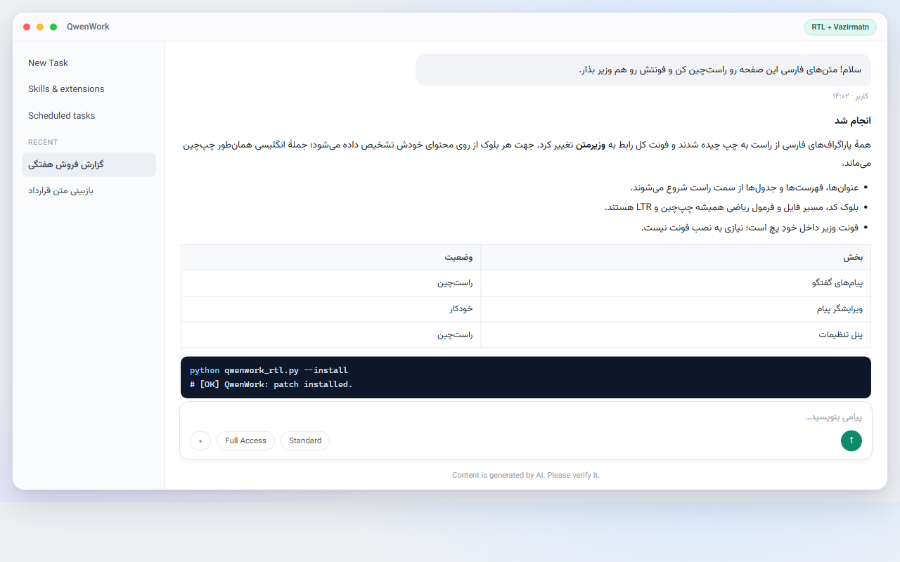

<div align="center">



# QwenWork RTL + Vazirmatn

**Persian (RTL) chat text and the Vazirmatn font for QwenWork — and it keeps working after app updates.**

[](CHANGELOG.md)
[](LICENSE)
[](#requirements)
[](#requirements)
[](https://github.com/neeM4c/qwenwork-rtl/stargazers)

[English](README.md) · [فارسی](README.fa.md) · [Usage guide](docs/USAGE.md) · [Donate](#-support-the-project)

</div>

---

## Why this exists

QwenWork ships an LTR-only interface with a Latin UI font. Persian conversations end up left-aligned,
wrapped the wrong way, with table columns in reverse reading order — and the text is hard to read in a
font that was never designed for Persian.

This tool edits one file inside the app (`out/renderer/index.html` in `resources/app.asar`) and adds a
small, self-contained snippet that:

- sets the **direction of every block from its own content** (Persian → RTL, English → LTR),
- loads **Vazirmatn**, embedded in the patch itself, so the whole UI gets a proper Persian typeface.

There is no server, no telemetry, no installer, no background service other than the optional guard.

<details>
<summary>Expand: what exactly changes inside the app</summary>

One `<style>` block and one `<script>` block are inserted right before `</head>` in the renderer HTML.
Both are wrapped in `<!-- RTL-PATCH-START -->` / `<!-- RTL-PATCH-END -->` markers, so removing the patch
is a byte-exact revert. The asar header sizes, per-file offsets and the integrity block of that single
entry are recomputed, then every packed file is verified before the archive is swapped in.

</details>

## Features

| Feature | Detail |
| --- | --- |
| **Automatic direction** | Every paragraph, heading, list item, table cell and message block is measured individually. Persian content goes right-to-left, English content stays left-to-right. No global "mirror the UI" hack. |
| **Vazirmatn built in** | The variable font (~240 KB) is base64-embedded inside the patch. Nothing to install, nothing to download, works offline. |
| **Code stays LTR** | Code blocks, inline code, KaTeX formulas, the terminal and the Monaco editor are pinned to left-to-right so nothing gets scrambled. |
| **Live streaming safe** | A `MutationObserver` re-evaluates as tokens stream in, so the direction flips correctly the moment the first Persian character arrives. |
| **Composer aware** | The message box flips to RTL as soon as you type Persian and back to LTR for English. |
| **Survives updates** | An optional logon guard re-applies the patch within seconds whenever an update replaces the archive. |
| **One-command undo** | `--restore` removes the injected block and returns the original file. |
| **No dependencies** | Standard-library Python only. No pip install, no Node, no external binaries. |

## Requirements

- **Windows 10 or 11** (the patch targets QwenWork for Windows)
- **QwenWork** installed in `C:\Program Files\QwenWork` (the default location) or in `%LOCALAPPDATA%\Programs\QwenWork`
- **Python 3.8+** installed and available as `python` or `py`
- Administrator rights — the archive lives under `Program Files`; the script asks for elevation itself

## Quick start

```powershell
git clone https://github.com/neeM4c/qwenwork-rtl.git
cd qwenwork-rtl
python qwenwork_rtl.py --install
```

Prefer clicking? Download the repository as a ZIP, extract it, and double-click **`QwenWork-RTL.bat`**
(choose option `1`). Accept the UAC prompt when Windows asks.

What happens next:

1. QwenWork is closed if it is running (this is required to unlock the archive).
2. The patch is injected, the archive is rebuilt and verified.
3. QwenWork starts again — open any Persian conversation and it is right-aligned in Vazirmatn.

## Usage

Run the script with no arguments for a small menu:

```text
  [1] Install / update patch
  [2] Show status
  [3] Remove patch (restore the original look)
  [4] Install / repair the auto-repair guard
  [5] Remove the auto-repair guard
```

Everything is also available from the command line:

| Command | What it does |
| --- | --- |
| `python qwenwork_rtl.py --install` | Apply, update or repair the patch (asks for admin rights). |
| `python qwenwork_rtl.py --status` | Show whether the archive is found, patched, current, and whether the guard is installed. |
| `python qwenwork_rtl.py --restore` | Remove the patch and return the original rendering. |
| `python qwenwork_rtl.py --install-guard` | Register the logon guard (scheduled task `RTL Patch Guard`). |
| `python qwenwork_rtl.py --remove-guard` | Unregister the guard. |
| `python qwenwork_rtl.py --watch --silent` | Run the guard loop in the foreground (used by the scheduled task). |

Full walkthrough, screenshots-free step by step, and troubleshooting: **[docs/USAGE.md](docs/USAGE.md)**.

## Keeping it after updates

Updates replace `app.asar`, which removes the patch. Two mechanisms keep it alive:

- the script never hardcodes a version folder — it reads `updater.cfg` (`currentVersion`) and falls back to
  the newest version directory, so a new version is found automatically;
- **the guard**: a scheduled task that starts at logon with the highest privileges and checks every 15 seconds.
  When it sees an unpatched, closed QwenWork, it re-applies the patch by itself.

```powershell
python qwenwork_rtl.py --install-guard   # one time
python qwenwork_rtl.py --status          # guard: True
```

Log file: `%LOCALAPPDATA%\RTL-Patch\guard.log`.

## Restore

```powershell
python qwenwork_rtl.py --restore
```

The injected block is removed from the archive and the original file comes back byte for byte. No leftover
backup files, no residual state. (You can also just run an update, but this is faster.)

## How it works

```text
resources/app.asar
└── out/renderer/index.html   ← one style block + one script block, nothing else
```

- The snippet is inserted immediately before `</head>` and wrapped in comment markers.
- Direction is chosen by the first strong character of each block (`[\u0600-\u06FF]` → RTL, `[A-Za-z]` → LTR),
  then applied as `dir="rtl"` with `text-align: right`.
- Elements matched by `pre`, `code`, `.katex`, `.monaco-editor`, `.xterm` and code/math slots are skipped.
- The asar is rebuilt with corrected header fields, entry offsets and per-entry SHA-256 integrity blocks,
  then every file is re-read and compared before the original archive is replaced.

## Troubleshooting

| Symptom | Fix |
| --- | --- |
| `archive is locked` | Quit QwenWork completely (also from the tray) and run again. |
| `No matching app found` | QwenWork is not in a supported location. Open an issue with your install path. |
| Patch applied but nothing changed | Reload the window with `Ctrl+R`. If the app had been open during patching, restart it. |
| Persian is RTL but the font looks unchanged | Another font rule may win in that panel — open an issue with a screenshot. |
| Patch disappears after every update | Install the guard (option `4` / `--install-guard`). |

## FAQ

<details><summary><b>Is this safe? Will it break my app?</b></summary>

The only change is one HTML file inside a packed archive. The rewritten archive is verified file by file
before it replaces the original, and `--restore` brings the original back. If anything goes wrong, run an
update from QwenWork and you are on the official build again.
</details>

<details><summary><b>Does it modify my account, sessions or chats?</b></summary>

No. Nothing is sent anywhere, no data leaves the machine, and only presentation (`dir`, `text-align`,
`font-family`) changes.
</details>

<details><summary><b>Why not a proper QwenWork setting?</b></summary>

Because there is none yet. This is a local, reversible workaround until the app supports RTL itself.
</details>

<details><summary><b>Does it work on macOS or Linux builds?</b></summary>

The patching logic is platform-agnostic, but the paths, the scheduled task and the elevation code are
Windows-specific. macOS/Linux support would need a small adapter — PRs welcome.
</details>

## ❤️ Support the project

If this saved you a headache, the cheapest and most useful thing you can do is **star the repository** —
it helps other Persian users find it.

<a href="https://github.com/neeM4c/qwenwork-rtl/stargazers"></a>

### Crypto donation

| | |
| --- | --- |
| **Coin** | USDT (Tether) |
| **Network** | BEP20 — BNB Smart Chain |
| **Address** | `0x9212739D586dA664E89857561a7aF9A163E610dA` |

```text
0x9212739D586dA664E89857561a7aF9A163E610dA
```

> Send **USDT on BEP20 (BNB Smart Chain)** only. Coins sent on another network (TRC20, ERC20, …) cannot be
> recovered. Thank you!

## Contributing

Issues and pull requests are welcome — see [CONTRIBUTING.md](CONTRIBUTING.md). If a panel of the app is still
left-aligned, a screenshot is enough to fix it: the CSS selector list is one place in the script.

## License

[MIT](LICENSE) © 2026 neeM4c. The embedded Vazirmatn font is licensed under the [SIL Open Font License 1.1](https://github.com/rastikerdar/vazirmatn/blob/master/OFL.txt).
